# Emporia — E-commerce Admin Dashboard for Angular

A free, production-ready admin dashboard template for online stores by **rrstudio**: sales KPIs,
orders you can fulfill, refund and cancel, a product catalog with variants, inventory with stock
adjustments, customers with segments, discount codes and store settings — with light/dark mode, six
accent colors and a fully responsive layout.

Built with the latest stable Angular and modern APIs only: **standalone components, signals,
`rxResource`, `linkedSignal`, Signal Forms, zoneless change detection, new control flow**.

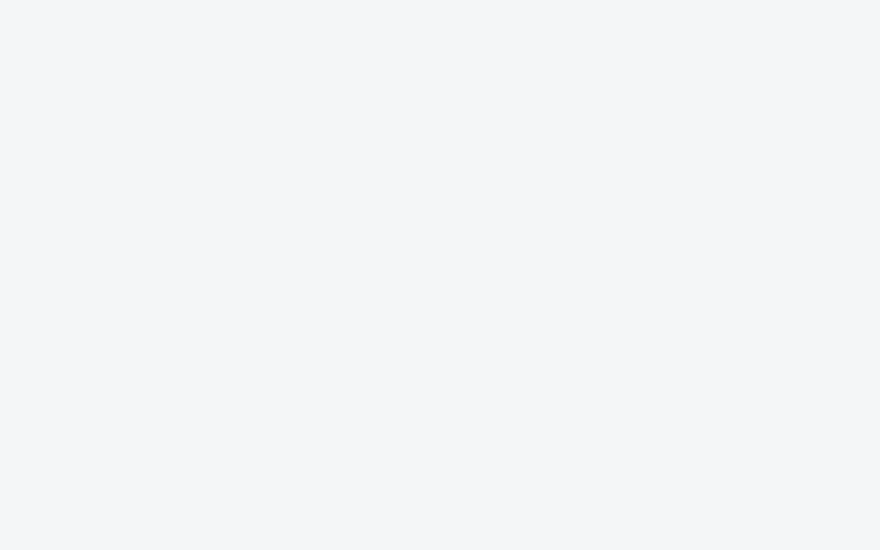

**[Try the live demo →](https://rrstudio.app/emporia/overview)** — no sign-up, runs entirely
in your browser on generated data.

> **About this repository:** this is the public home of Emporia — screenshots, release notes,
> bug reports and feature requests. The source code is distributed through
> **[Polar](https://buy.polar.sh/polar_cl_ei81VSYaO47yBUx0pQ7RzHWbb0JXVdNnQMs1e0DoamX)**: it is **free** (pay what you want, $0 is fine) and you always get the latest
> version.

---

## Screenshots

| Overview (light) | Overview (dark) |
|---|---|
| 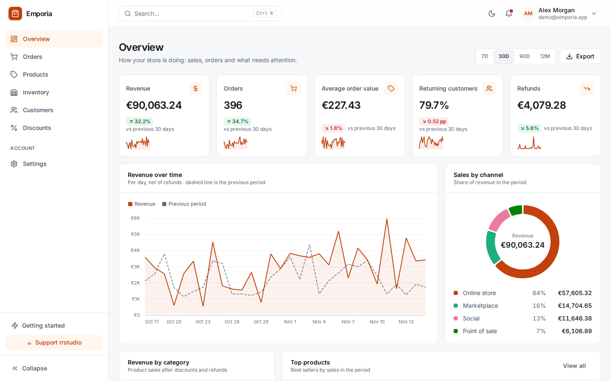 | 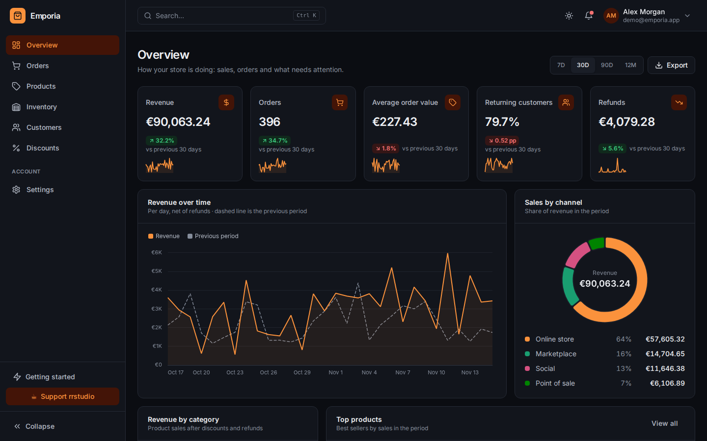 |

| Orders | Order |
|---|---|
| 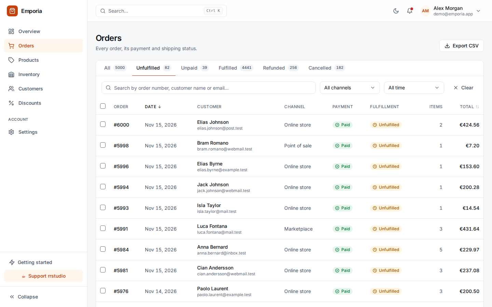 | 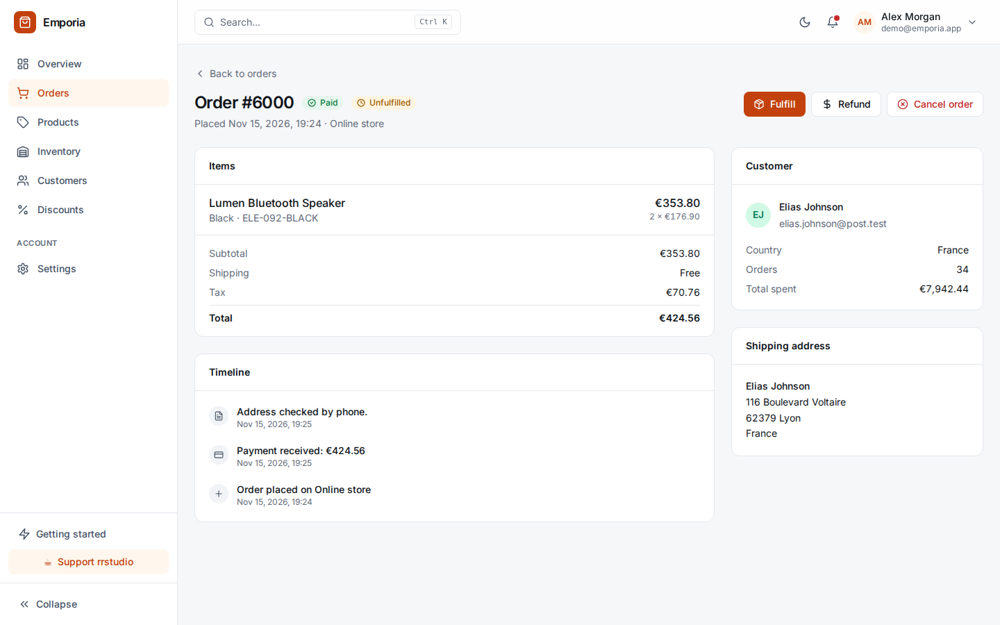 |

| Products | Product with variants |
|---|---|
| 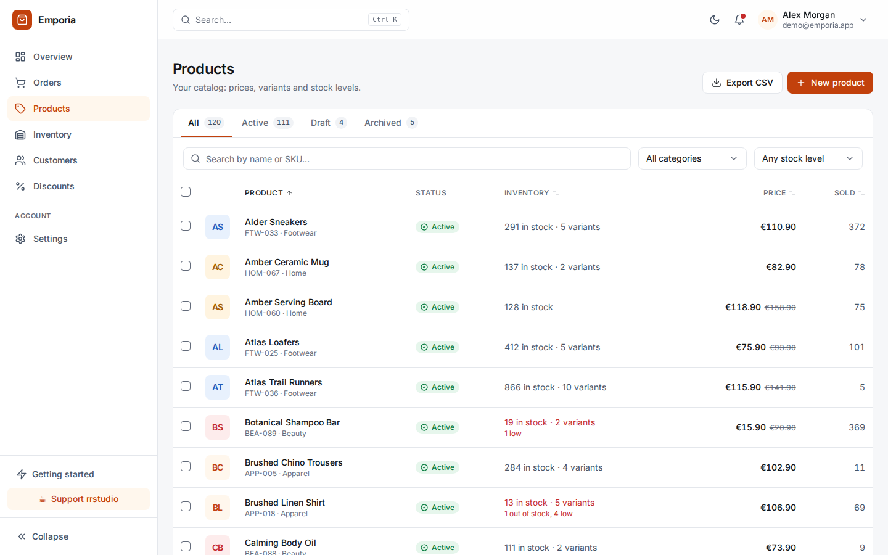 | 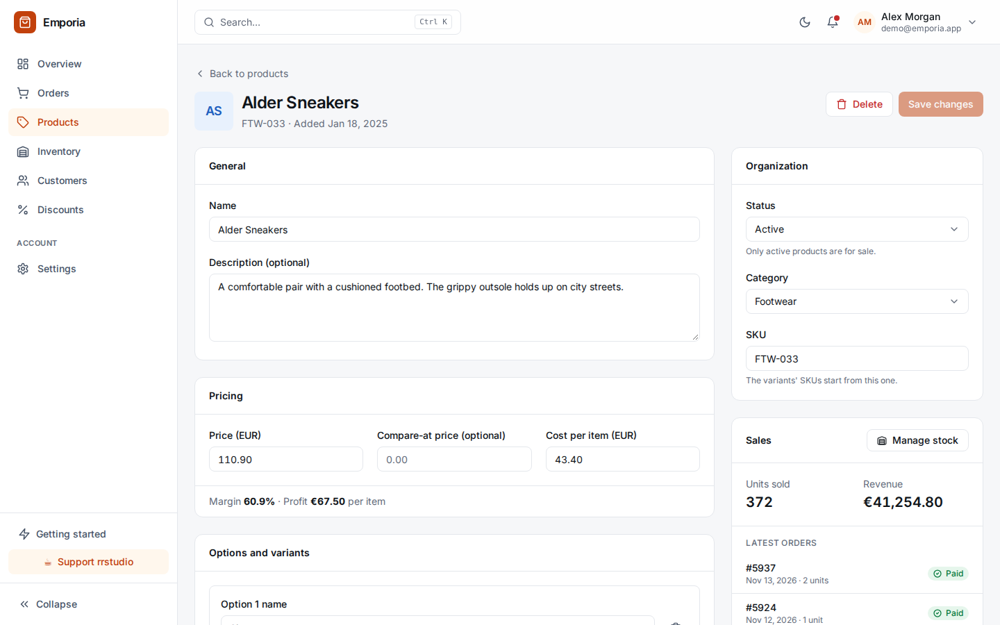 |

| Inventory | Customers |
|---|---|
| 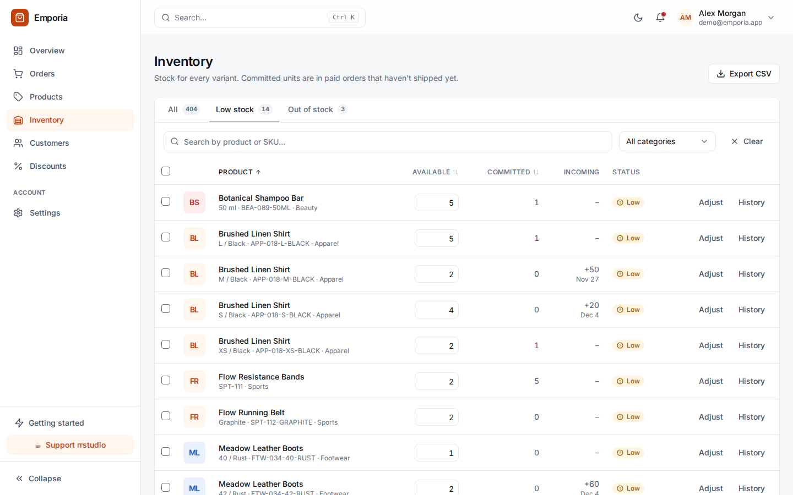 | 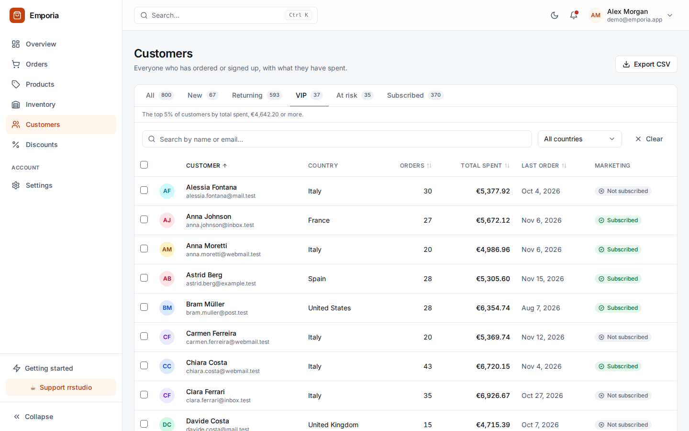 |

| Customer | Discounts |
|---|---|
| 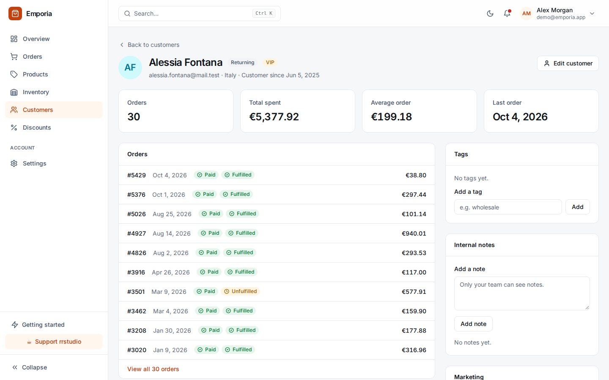 | 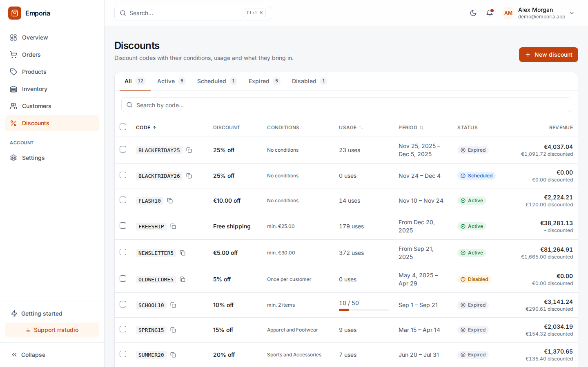 |

| Store settings | Mobile |
|---|---|
| 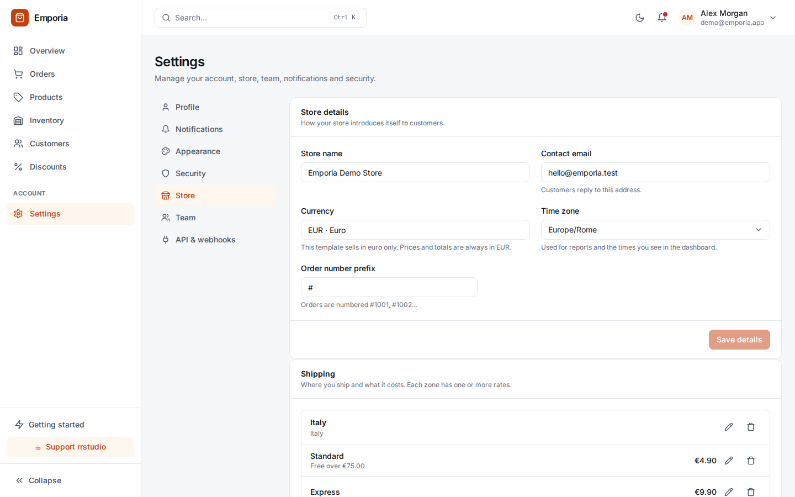 | 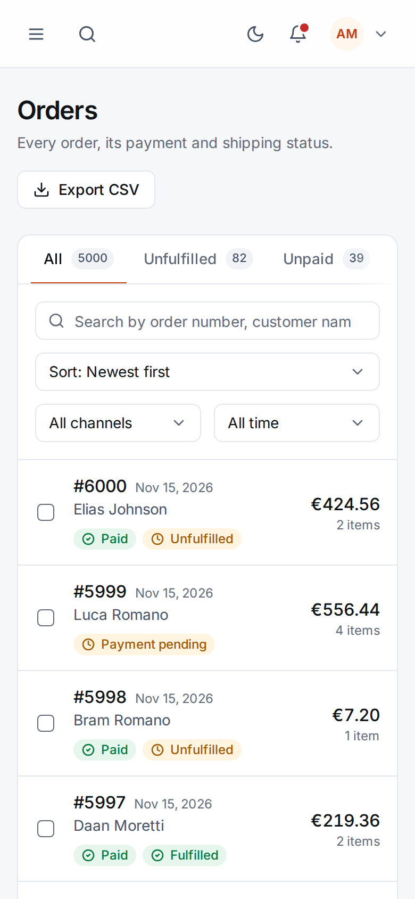 |

---

## Features

- **Overview** — KPI cards (revenue net of refunds, orders, average order value, returning customers,
  refunds) with the change against the previous period; revenue over time, sales by channel and
  revenue by category; top products, orders to ship, low stock and the most used discount codes.
  Period selector (7D/30D/90D/12M) and CSV export.
- **Orders** — status tabs with live counts, search, channel and period filters, sortable columns and
  paging kept in the URL, bulk "Mark as fulfilled" and CSV export. The order page shows items,
  totals, customer, shipping address and timeline, with **Fulfill** (carrier, tracking number,
  notify the customer), **Refund** (full or partial, with restock) and **Cancel**. Cards on phones.
- **Products** — catalog with status tabs, search by name or SKU, category and stock filters, bulk
  actions and CSV export. The product form has price, compare-at price, cost with live margin, and
  an options editor (Size, Color…) that generates the variants with SKU, price and stock each.
- **Inventory** — one row per variant with available, committed and incoming stock; adjust it in a
  dialog (add, remove or set, with a reason), inline or in bulk; history per variant.
- **Customers** — segments (New, Returning, VIP, At risk, Subscribed), search, country filter, tags,
  bulk actions; the customer page has orders, notes and a marketing switch.
- **Discounts** — percentage, fixed amount and free shipping codes with conditions, limits, dates
  and usage statistics; create, edit, bulk actions and delete with confirmation.
- **Store settings** — store details, shipping zones and rates, taxes, payment methods and checkout
  options.
- **Settings** — Profile, Security, Appearance, Notifications, Team and API & webhooks as
  deep-linkable tabs, with dirty tracking and validation. Appearance includes a **theme
  configurator**: light / dark / system, six accent colors and comfortable / compact density.
- **Team & roles** — Owner, Admin, Staff and Viewer roles drive menus, pages and buttons from one
  permission table, with a "no access" page. In the demo, **Preview as role** in the user menu shows
  the app as each role.
- **Auth** — login, registration with password strength meter, forgot/reset password, onboarding
  wizard, return-URL redirect after login.
- **Global** — command palette (Ctrl/⌘ K), notification feed, in-app 404 and 403 pages.

**Under the hood**

- Every route is **lazy loaded**; mock data and ECharts never land in the initial bundle.
- **One shared store state**: refunds, cancellations and edits show up everywhere (revenue, units
  sold, customer spend) and a refund with "Restock items" really puts the units back in stock.
- **Swappable API layer**: realistic mock data or HttpClient with one switch. Every endpoint is
  described in an **OpenAPI 3.1** contract
  ([getting started guide](https://rrstudio.app/docs/emporia/getting-started/)).
- Loading skeletons, empty and error states with Retry on every page — the demo lets you simulate a
  slow network and API errors from Settings → Appearance.
- **Accessible**: semantic landmarks, ARIA on tabs, menus and dialogs, full keyboard support,
  visible focus, WCAG AA contrast, color-blind safe chart palette.
- **Tested**: unit tests with Vitest and end-to-end tests with Playwright (desktop and mobile).
- No UI-library lock-in: small, readable components you own.

**Lighthouse note.** Accessibility and SEO score 100 on every page, Best practices 100 over HTTPS, and
desktop Performance is 93–100. Mobile scores are lower (61–87 with 4x CPU
throttling) because the demo generates about 5,000 fake orders in the browser; with your own API
that cost disappears.

## Tech stack

| | |
|---|---|
| Framework | Angular 22 (standalone, zoneless, OnPush everywhere) |
| State | Signals, `computed`, `linkedSignal`, `rxResource` |
| Forms | Angular Signal Forms |
| Styling | Tailwind CSS 4 with semantic design tokens |
| Charts | Apache ECharts 6 via `ngx-echarts` (tree-shaken, lazy-loaded) |
| Icons | Lucide (inline SVG) |
| Tests | Vitest, Playwright |

## Get it

1. **[Download Emporia for free on Polar](https://buy.polar.sh/polar_cl_ei81VSYaO47yBUx0pQ7RzHWbb0JXVdNnQMs1e0DoamX)** — enter $0 or any amount you like.
2. Unzip, then `npm install` and `npm start`. The included README covers installation,
   connecting your own API, theming, adding pages and deployment.
3. Follow the **[Getting started guide](https://rrstudio.app/docs/emporia/getting-started/)**:
   rebrand it, add a page, connect your backend, apply roles and deploy, step by step.

New versions are announced in [Releases](../../releases). Downloading again from Polar always gives
you the latest one.

## Feedback

- Found a bug? [Open a bug report](../../issues/new?template=bug_report.yml).
- Missing something? [Request a feature](../../issues/new?template=feature_request.yml).
- Anything else: [rrstudio.apps@gmail.com](mailto:rrstudio.apps@gmail.com).

## License

Emporia is free to use in your personal and commercial projects, including projects for your
clients. You may not resell or redistribute the template itself as a template, theme or UI kit.
The full terms are in the **rrstudio Template License** shipped with the download — see
[LICENSE](LICENSE).

## Support

Emporia is free. If it saves you time, you can support its development on
[Ko-fi](https://ko-fi.com/rrstudioapps) ☕ — thank you!
